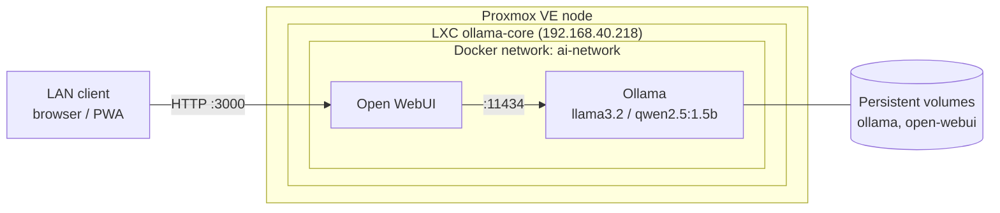
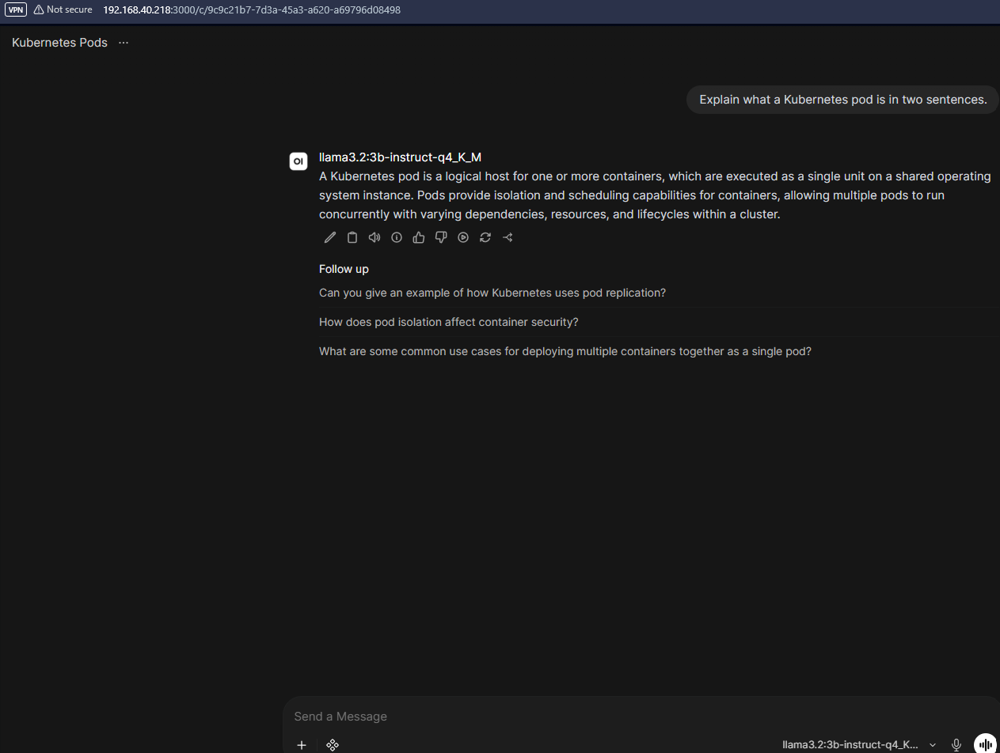

# Self-Hosted Private AI Infrastructure

**End-to-End Homelab Deployment & Configuration Guide**

- **Date:** June 2026
- **Target Environment:** Proxmox VE (LXC Container)
- **Author:** Philip Obour-Bonsu
- **Stack:** Proxmox VE · LXC · Docker · Ollama · Open WebUI · Llama 3.2 · Qwen 2.5

---

## 1. Executive Summary

This project documents the end-to-end engineering, implementation, and resource optimization of a 100% private, self-hosted AI platform deployed in a home lab. Using open-source containerization and quantized large language models, the architecture delivers local AI capabilities independent of external cloud ecosystems, vendor lock-in, or internet dependencies.

**Key Objective:** Absolute data privacy, near-zero latency via localized networking, and data sovereignty over all input/output traffic.

### Architecture Overview



---

## 2. Proxmox LXC Resource Provisioning

The platform is hosted in a dedicated Linux Container (LXC) on a bare-metal Proxmox Virtual Environment (PVE) node. This hypervisor-level virtualization isolates processing dependencies while eliminating the overhead of a full virtual machine (VM).

### 2.1 Container Configuration Parameters

| Parameter | Specification / Value | Engineering Justification |
|---|---|---|
| CT ID | `100` (or next sequential ID) | Unique cluster resource identifier |
| Hostname | `ollama-core` | DNS-compliant service designation |
| OS Template | `ubuntu-24.04-standard` | Stable Linux distribution with modern Docker support |
| CPU Cores | `4` | Optimized multi-threading for CPU-bound matrix math |
| Memory (RAM) | `4.0 GB` | Sized strictly for small-footprint quantized LLMs |
| Swap Space | `512 MB` | Safeguard against OOM kernel termination loops |
| Disk Size | `40 GB` (Rootfs NVMe) | Accommodates container layers and multiple model files |

---

## 3. Network Engineering & Resolution

Initial provisioning hit network drops caused by external DNS resolution loops. The environment defaulted to upstream public resolvers (`1.1.1.1`), which caused timeouts when fetching external image layers over secure channels.

### 3.1 Network Interface Mapping

The networking was stabilized by configuring the container to use the home router as its gateway and DNS server, allowing traffic out to GitHub's container registry (`ghcr.io`).

- **Bridge:** `vmbr0`
- **IPv4 Address:** `192.168.40.218/24` (static)
- **Gateway (IPv4):** `192.168.40.1`

```ini
# File: /etc/resolv.conf (configured via Proxmox host GUI network panel)
search local
nameserver 192.168.40.1
```

### 3.2 Proxmox Host Firewall Management

To prevent automated drop rules from intercepting standard network traffic, the Proxmox interface-level firewall checkbox for `net0` was left unchecked. This relies on the edge router's NAT protections within the private `192.168.40.x` subnet, avoiding administrative overhead during high-volume container pulls.

### 3.3 Isolated Docker Network Creation

Once the container OS was updated and verified, a dedicated bridge network was created in the Docker daemon for intra-service communication without relying on loopback addresses:

```bash
docker network create ai-network
```

---

## 4. Multi-Container Orchestration Setup

The platform follows a microservices pattern, separating the compute-heavy execution backend from the front-end presentation layer.

### 4.1 Execution Engine Deployment (Ollama Backend)

Ollama manages LLM lifecycles, memory pinning, and tensor processing on the host CPU. A persistent volume mount ensures downloaded models survive container restarts.

```bash
docker run -d \
  --name ollama \
  --network ai-network \
  -v ollama:/root/.ollama \
  --restart unless-stopped \
  ollama/ollama
```

### 4.2 Interface Layer Deployment (Open WebUI Frontend)

Open WebUI provides a dashboard mirroring advanced cloud-AI applications, connected to the local backend through an environment variable over port `11434`.

```bash
docker run -d \
  --name open-webui \
  --network ai-network \
  -p 3000:8080 \
  -e OLLAMA_BASE_URL=http://ollama:11434 \
  -v open-webui:/app/backend/data \
  --restart unless-stopped \
  ghcr.io/open-webui/open-webui:main
```

### 4.3 Reproducible Deployment (Docker Compose)

The same stack is defined in [`docker-compose.yml`](docker-compose.yml) for one-command, repeatable deployment:

```bash
docker compose up -d
```

---

## 5. Large Language Model Selection & Optimization

With a strict 4.0 GB RAM footprint, dense 7B+ parameter models risk out-of-memory errors or aggressive swapping. The strategy prioritizes high-capability small models with modern quantization.

- **Primary Choice:** `llama3.2` (3B parameters): strong reasoning, fast CPU token generation, fits fully in local RAM.
- **Fallback Speed Choice:** `qwen2.5:1.5b` (1.5B parameters): low-latency alternative for rapid text output.

### 5.1 Orchestrating Model Downloads

Models are pulled through Open WebUI's connection settings:

1. Navigate to **Admin Panel → Settings → Connections**.
2. Locate the active Ollama API connection pointing to `http://ollama:11434`.
3. Open the **Manage Ollama** overlay via the download/pull menu.
4. Enter the model identifier `llama3.2` and pull it to the persistent volume.

---

## 6. Cross-Device Mobility & PWA Packaging

The frontend is reachable from any local device on the `192.168.40.x` network at:

```
http://192.168.40.218:3000
```

For regular use, the platform was installed as a Progressive Web App (PWA) on target machines, giving app-like behavior on mobile and desktop without exposing endpoints to the public internet.

---

## 7. Verification & Performance

Verify the deployment:

```bash
docker ps                                   # both containers running
docker exec ollama ollama list              # models present
curl http://localhost:11434/api/tags        # Ollama API reachable
docker exec ollama ollama run llama3.2 "Say hello in one sentence."
```

Measured on 4 vCPU / 4 GB RAM (CPU-only inference):

| Model | Size on disk | RAM in use | Tokens/sec |
|---|---|---|---|
| `llama3.2` (3B) | TBD | TBD | TBD |
| `qwen2.5:1.5b` | TBD | TBD | TBD |

> Tip: `docker exec ollama ollama run <model> "<prompt>" --verbose` prints the eval rate.



*Open WebUI on the LAN (`192.168.40.218:3000`) answering a prompt with `llama3.2:3b-instruct-q4_K_M`.*

Proxmox container summary: `images/proxmox-container-summary.png` (TBD)

---

## 8. Security Considerations

- **Network exposure:** The service is LAN-only and not published to the internet. No port forwarding is configured on the router.
- **Firewall trade-off:** The Proxmox `net0` firewall was left off during provisioning (see 3.2). Hardening step: enable it and allow only TCP 3000 from the trusted LAN subnet.
- **Open WebUI access:** Create the admin account on first launch, then disable open sign-ups (Admin Panel → Settings → General).
- **Remote access:** Use a VPN overlay such as Tailscale rather than exposing port 3000.
- **Data sovereignty:** Prompts and responses never leave the LXC. Models are pulled once, then inference runs offline.

---

## 9. Troubleshooting & Lessons Learned

| Problem | Cause | Fix |
|---|---|---|
| Image pulls from `ghcr.io` timed out | Container resolved DNS through upstream `1.1.1.1` | Pointed `nameserver` at the home router (`192.168.40.1`) |
| Risk of OOM kills with larger models | 4 GB RAM ceiling | Chose 3B and 1.5B quantized models; kept 512 MB swap as a safeguard |

---

## 10. Operations & Maintenance

- **Update images:** `docker compose pull && docker compose up -d`
- **Back up volumes:** snapshot the LXC in Proxmox (or Proxmox Backup Server), or archive the `ollama` and `open-webui` Docker volumes.
- **Add models:** Admin Panel → Settings → Connections → Manage Ollama, or `docker exec ollama ollama pull <model>`.
- **Future work:** Prometheus/Grafana monitoring, Ansible role to rebuild the LXC end to end, GPU/larger-model evaluation.
